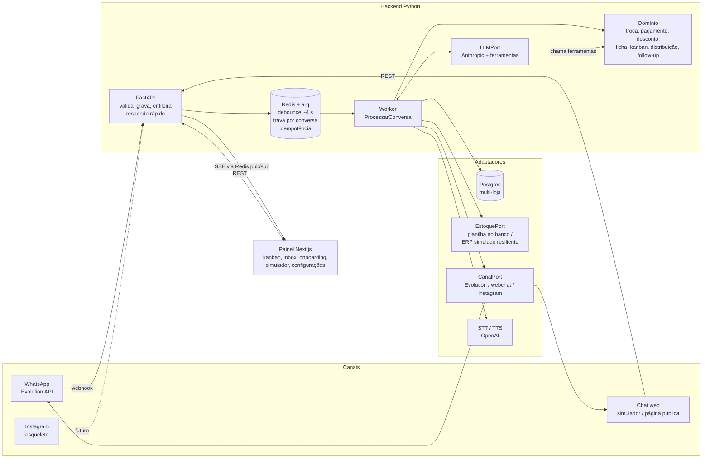

# Agente de Atendimento Mobile

Uma IA que atende leads de lojas de celular (foco em iPhone, com troca do usado), entende o aparelho desejado, consulta o estoque, qualifica o cliente, calcula troca e parcelas e entrega a venda pronta para o vendedor, com resumo, opção de assumir a conversa e opção de devolvê-la para a IA.

> Link do vídeo/demo: **(a preencher)**

## O que já funciona

- **Atendimento**: entende o aparelho, consulta o estoque, qualifica (usado: tela, traseira, carcaça, bateria, câmera; data da compra; forma de pagamento) e só então passa preço, troca e parcelas.
- **Canais**: WhatsApp via Evolution API e chat web (simulador no painel e página pública `/chat/{loja}`). Instagram: adaptador esqueleto, testado com fixtures, não ligado à Graph API (ver [docs/instagram.md](docs/instagram.md)).
- **Kanban** de 5 etapas (`Novo contato → Interesse identificado → Interesse qualificado → Com o vendedor → Venda fechada`), atualizado em tempo real por SSE.
- **Inbox** com ficha do cliente, resumo do handoff, **Assumir** e **Devolver para a IA**. O vendedor também pode responder direto pelo celular: a IA percebe o `fromMe` e silencia.
- **Distribuição de leads por porcentagem** entre vendedores (ex.: 50/30/20), com resumo e link da conversa enviados ao WhatsApp do vendedor.
- **Visão**: lê foto do aparelho e print da saúde da bateria.
- **Áudio**: entende áudio recebido (STT) e responde em nota de voz (TTS), opcional por loja ([docs/audio.md](docs/audio.md)).
- **Follow-up automático** para o lead que parou de responder (padrão desligado; configurável por loja).
- **Onboarding** de loja no painel: 8 passos com importação das planilhas modelo.
- **Qualidade**: 1.768 testes automatizados, eval do agente com LLM real, CI com lint, tipos e verificação de camadas.

O que **não** foi validado: conversa ponta a ponta com um celular pareado de verdade (formato real dos webhooks, mídia, entrega) e Instagram na Graph API. Ver [Riscos e pendências](#riscos-conhecidos-e-pendências).

## A tese: a IA conduz, o código decide

O LLM conversa, extrai dados para a ficha e chama ferramentas. Ele **nunca** calcula preço, nunca move o kanban e nunca decide se pode passar preço. Isso vira regra de domínio com teste, não instrução de prompt. Exemplos concretos:

| Decisão | Quem decide | Como |
|---|---|---|
| Pode passar preço? | Código | `consultar_estoque` nunca devolve preço. Troca, parcelas e desconto só saem de `calcular_proposta`/`liberar_desconto`, que **recusam** enquanto a ficha tiver pendências e devolvem a lista do que falta (`domain/ficha.py`). |
| Valor do usado | Código | `valor_troca = valor sem detalhes − Σ descontos`; desconto de bateria só abaixo do limite; `SEM`, peça trocada, câmera/outro defeito, modelo fora da tabela ou valor ≤ 0 mandam para "avaliação na loja" (`domain/troca.py`). Exemplo testado: iPhone 16 128GB, tela trincada, bateria 79% = R$ 2.310. |
| Parcela | Código | `(preço − desconto − troca − entrada) × (1 + taxa/100) ÷ n` em `Decimal` com `ROUND_HALF_UP`. Exemplo testado: R$ 4.830 em 12x a 10,54% = R$ 444,92. |
| Desconto | Código | Liberado em degraus até um **teto** por cliente, configurado pela loja. O LLM pede, o código concede ou nega. |
| Etapa do kanban | Código | Derivada de fatos (aparelho definido, estoque consultado, ficha completa, handoff). Nunca regride sozinha; "Venda fechada" só o vendedor marca (`domain/kanban.py`). |
| Leitura de imagem | Código | O LLM devolve a leitura estruturada (modelo, bateria, danos, confiança). O código só grava na ficha com **confiança ≥ 0,8**; abaixo disso, devolve a pergunta de confirmação ao cliente. |
| Follow-up | Código | `domain/followup.py` decide se, quando e quantas vezes (etapa, horas parado, tentativas, intervalo, horário comercial, dono = IA). O LLM só redige a mensagem, sem valores. |
| Resumo do handoff | Código + LLM | Os campos (aparelho, troca, pagamento) vêm da ficha; o LLM só acrescenta 2 a 3 frases de observações. |

Consequência prática: como o modelo só conversa, um modelo barato basta (ver [Modelo e custo](#modelo-e-custo)). E o eval tem checagens automáticas que reprovam a conversa se aparecer um valor em reais que não veio de uma ferramenta.

## Arquitetura



Fluxo de uma mensagem: o webhook (ou a API do chat web) normaliza, grava com idempotência por `(canal, id_externo)` e só enfileira. O arq espera ~4 s para juntar a rajada do cliente num único turno (debounce) e uma trava por conversa no Redis garante um worker por vez e a ordem das mensagens. O `ProcessarConversa` roda o laço LLM + ferramentas, as ferramentas chamam casos de uso que chamam o domínio, o kanban é recalculado e a resposta sai pelo canal de origem. Se a conversa pertence a um vendedor, o worker só persiste. Todo `ErroLLM` (inclusive falta de chave) vira mensagem de espera e handoff para um vendedor: o cliente nunca fica sem resposta.

### Camadas (Clean Architecture / Ports & Adapters)

```
backend/app/
  domain/        regras puras (dinheiro, troca, pagamento, desconto, ficha, kanban, distribuição, follow-up). Sem IO.
  application/   casos de uso e portas (typing.Protocol). Importa só domain.
  adapters/      inbound (FastAPI, webhooks, SSE) e outbound (db, estoque, llm, canal, áudio).
  infra/         settings, composição das dependências, fila e worker.
services/erp-mock/   ERP simulado (FastAPI separado)
frontend/            painel Next.js
infra/               docker-compose, smoke, teste de carga k6
```

A regra de dependência é verificada pelo **import-linter** (`uv run lint-imports`), que quebra o build do CI se `domain` importar o projeto ou bibliotecas de infraestrutura, ou se `application` importar `adapters`/`infra`. Os adaptadores de uma mesma porta (ex.: os de estoque) passam na **mesma suíte de testes de contrato**.

## Stack e por quê

| Camada | Escolha | Por quê |
|---|---|---|
| API | Python 3.12, FastAPI, Pydantic v2, `uv` | Async para webhooks e chamadas ao LLM; ecossistema de IA; contrato OpenAPI que gera o cliente TypeScript do painel. |
| Banco | Postgres 16, SQLAlchemy 2 async, Alembic | Multi-loja (`loja_id` em tudo), transações, JSONB para a ficha, migrations versionadas. |
| Fila | Redis + arq | Debounce, trava e ordem por conversa; escala horizontal subindo mais workers; mesmo Redis serve o pub/sub do SSE. |
| LLM | Anthropic SDK; Haiku 5.5 e Sonnet 5.5 (configuráveis por env); prompt caching | Tool use e visão nativos; **fallback de modelo** em 429/5xx; o cache do prefixo (ferramentas + system + conversa) corta o custo de entrada. Modelo escolhido por eval, não por achismo. |
| WhatsApp | Evolution API v2 self-hosted (Docker) | Sem custo por mensagem, conecta por QR code, entrega `fromMe` (a IA silencia quando o vendedor digita no celular). Risco: não é a API oficial. |
| Tempo real | SSE (`/lojas/{id}/eventos`) sobre Redis pub/sub | Unidirecional basta para o painel; sem websockets nem serviço externo (descartamos Supabase para rodar tudo local). |
| Painel | Next.js 16, React 19, Tailwind 4, shadcn/ui, dnd-kit, Vitest + Testing Library | Produtividade; **design system** com tokens (CSS variables) e componentes próprios, sem cor ou espaçamento hardcoded (`DESIGN.md`). |
| Áudio | OpenAI `gpt-4o-mini-transcribe` e `gpt-4o-mini-tts` via `httpx` | Bom português, barato, sem SDK novo; chave opcional (sem ela o agente pede ao cliente que digite). |
| Testes | pytest (+ hypothesis no domínio), Vitest, k6 | TDD; propriedades para dinheiro e desconto. |
| Qualidade | ruff, mypy, import-linter, ESLint, GitHub Actions | Erros pegos cedo; camadas garantidas por build. |
| Execução | Docker Compose para a infra; API, worker e painel no host | Simples e reprodutível; a Evolution alcança o webhook por `host.docker.internal`. |

## Modelo e custo

O custo abaixo é **medido** (uso de tokens registrado no eval com LLM real, 2026-11-21), só do agente. Detalhes, premissas e como regenerar: [docs/custos.md](docs/custos.md).

| Modelo | Cenários / aprovados | Custo médio por conversa |
|---|---|---|
| Haiku 5.5 | 15 / **14** | **~US$ 0,004** |
| Sonnet 5.5 | 3 / 1 (amostra pequena; as 2 reprovações foram de uma checagem de handoff que depois saiu do eval) | ~US$ 0,079 |

- O **cache incremental da conversa** (commit `5a1145c`) cortou o custo do Sonnet em cerca de 55%. Sem cache de prompt, a mesma conversa custaria 76% (Haiku) a 81% (Sonnet) mais.
- **Recomendação: Haiku 5.5 como principal**, cerca de 1/20 do custo do Sonnet. A única reprovação (`mente_tela_perfeita`) foi de tamanho de mensagem; as travas de negócio (valor só de ferramenta, desconto no teto) passaram em todos os cenários.
- **Configuração atual: o `.env.example` vem com `LLM_MODEL=claude-sonnet-5-5` e `LLM_FALLBACK_MODEL=claude-haiku-5-5`**, ou seja, Sonnet como principal e Haiku como reserva. Para usar o Haiku como principal, troque no `.env`: `LLM_MODEL=claude-haiku-5-5` (e, se quiser, `LLM_FALLBACK_MODEL=claude-sonnet-5-5`). Nada mais muda.

Projeção mensal (1 lead = 1 conversa). LLM é medido; áudio (30% das conversas com áudio) e infra são **estimativas**:

| Volume | Modelo | LLM | Áudio (STT+TTS) | Infra | Total |
|---|---|---|---|---|---|
| 1 mil leads/mês | Haiku 5.5 | US$ 4,01 | US$ 5,04 | US$ 20 a 50 | **US$ 29 a 59** |
| 1 mil leads/mês | Sonnet 5.5 | US$ 78,77 | US$ 5,04 | US$ 20 a 50 | **US$ 104 a 134** |
| 10 mil leads/mês | Haiku 5.5 | US$ 40,09 | US$ 50,40 | US$ 40 a 100 | **US$ 130 a 190** |
| 10 mil leads/mês | Sonnet 5.5 | US$ 787,74 | US$ 50,40 | US$ 40 a 100 | **US$ 878 a 938** |

Com Haiku, o áudio pesa mais que o LLM; desligar o TTS (opcional por loja) é a principal alavanca. Fora da conta: WhatsApp oficial (a Evolution self-hosted não cobra por mensagem), domínio, monitoramento e mão de obra. A média vem de conversas roteirizadas do eval; conversas reais curtas ou longas mudam o custo na mesma proporção (o script aceita `--banco` para recalcular com dados reais).

## Qualidade

- **Testes** (rodados para este README): backend **1.454** (1.290 unitários + 164 de integração com Postgres), ERP simulado **35**, frontend **279**, eval fake **6/6**. Total **1.768** (sem contar o eval).
- **Eval do agente** (`backend/evals/`): 15 cenários de conversa (preço logo de cara, cliente que mente sobre a tela, prompt injection, troca com defeito, pedir desconto três vezes contra o teto, etc.) mais controle negativo (cenário que viola uma regra de propósito e **precisa** ser reprovado, para provar que a checagem funciona). 11 checagens automáticas: sem valor antes da proposta, valores só vindos de ferramenta, desconto dentro do teto, etapa final, handoff, uma pergunta por mensagem, tamanho máximo, frase de pré-avaliação, sem erro de ferramenta, sem frases proibidas, valores esperados ditos.
- **Modo fake** (grátis; valida o harness e as checagens, coberto pelos testes do CI); **modo real** só com `--confirmo-custo` (imprime a estimativa antes).
- **CI** (GitHub Actions): ruff, ruff format, mypy, import-linter, pytest com integração obrigatória, ESLint, typecheck, testes e build do frontend, testes do ERP simulado e validação do docker-compose.
- **Testes nunca chamam API paga**: LLM, STT e TTS são substituídos por fakes.

## Black Friday

Números do teste de carga (k6, LLM simulado sem custo, tudo na mesma máquina de 4 vCPU; detalhes e limites em [docs/black-friday.md](docs/black-friday.md), reproduzível com [infra/k6/README.md](infra/k6/README.md)):

| Cenário | Workers | Ingestão p99 | Fila máx. | Fila esvazia | Até a resposta p95 |
|---|---|---|---|---|---|
| 1x (40 msg/min) | 1 | 39 ms | 5 | 6 s | 8,3 s |
| **10x (400 msg/min)** | 1 | 42 ms | 618 | 65 s | 75,6 s |
| **10x (400 msg/min)** | **2** | 43 ms | 49 | 8 s | **8,1 s** |
| 20x (800 msg/min) | 2 | 37 ms | 755 | 41 s | 43,1 s |

- **10x sem perda nem duplicação**: em todas as execuções, 0 mensagens perdidas, 0 duplicadas (inclusive com 5% de reentregas simultâneas do mesmo id) e todas as conversas respondidas.
- **2 workers aguentam 10x** com folga e ainda seguram ~20x com atraso moderado. Com 1 worker a fila cresce, mas só atrasa (até 80 s), não perde.
- **O webhook não é o gargalo**: só valida, grava e enfileira (p99 ≈ 43 ms), então a Evolution nunca dá timeout nem reenvia por culpa da API.
- **O gargalo real são os slots dos workers e o rate limit do LLM.** Em produção (~9 s por turno em vez dos 2,75 s simulados), 10x pede ~3 a 4 workers e ~28 chamadas simultâneas ao LLM por loja: confirmar e pedir aumento do limite da conta Anthropic **antes** da data. O risco do WhatsApp (Evolution/Baileys) é o bloqueio do número, não a capacidade da API.

Plano: (antes) aumentar o limite do LLM, repetir o k6 em staging e dimensionar workers pela conta `ceil(turnos/min × s por turno / 60 / 10)`, ensaiar a falha do LLM (retry → modelo reserva → "já te respondo" + vendedor); (no dia) subir workers extras antes da campanha e acompanhar jobs prontos na fila, p95 até a resposta e taxa de fallback; (depois) conferir recebidas × respondidas e medir o custo real. O teste **não** cobre o LLM real, a Evolution real nem várias lojas no mesmo worker.

## Loja nova no ar em menos de 1 dia

A plataforma é multi-loja: loja nova é **dados**, não deploy. O painel tem um assistente de 8 passos em `/onboarding`, com checklist de progresso (persiste ao recarregar), grades editáveis com erro por célula e importação de planilha (validar → aplicar; nunca grava dados inválidos). As planilhas modelo vazias estão em [docs/modelos](docs/modelos): `modelo-troca.xlsx`, `modelo-taxas.xlsx` e `modelo-estoque.xlsx`.

| # | Passo | O que fazer | Tempo estimado |
|---|---|---|---|
| 1 | Dados da loja e tom | Nome, endereço, horários, jeito de falar, opção de responder em áudio | 5 min |
| 2 | Vendedores e distribuição | Cadastrar vendedores, WhatsApp de cada um e porcentagens (soma 100) | 5 min |
| 3 | Regras de preço | Máximo de parcelas, repasse de taxa, desconto Pix, teto de desconto, "oportunidade única" | 10 min |
| 4 | Taxas da maquininha | Importar `modelo-taxas.xlsx` (taxa por parcela e bandeira) ou editar na grade | 10 min |
| 5 | Tabela de troca | Importar `modelo-troca.xlsx` (valor por modelo + capacidade e descontos por defeito). É o passo mais trabalhoso: a loja precisa decidir seus valores | 30 a 90 min |
| 6 | Estoque / ERP | Importar `modelo-estoque.xlsx` ou apontar o ERP e mapear os SKUs | 15 a 45 min |
| 7 | Conectar WhatsApp | Escanear o QR code do número da loja (a instância é criada pela API) | 5 min |
| 8 | Conversa de teste | Conversar no simulador como cliente, conferir preço, troca e handoff | 15 a 30 min |

**Total estimado: de ~1,5 h a ~4 h**, dominado por preencher a tabela de troca e o estoque. Os tempos são **estimativas** minhas, não medição com um lojista real. Dois pontos que ajudam: a configuração é lida a cada turno (o que muda no painel vale na próxima mensagem) e o checklist da API mostra exatamente o que ainda falta. A primeira instalação da plataforma (servidor, `.env`, Evolution) é uma vez só, na ordem de 1 a 2 h.

## Integração com o ERP (Mercado Phone)

O estoque e os preços da loja podem vir do ERP Mercado Phone, lido por um servidor MCP. Quem fala com o ERP é o backend, por um adaptador atrás de `EstoquePort`; a IA nunca recebe as ferramentas do MCP nem a chave (uma allowlist de 8 ferramentas, sem nenhuma de exclusão).

- **Conectar**: `MERCADOPHONE_API_KEY` no `.env`; no painel, `/configuracoes` > **Conexão com o ERP** (unidade, filtro da loja, intervalo, **Testar conexão**, **Sincronizar agora**).
- **Sincronização**: cron do worker a cada 5 min respeitando o intervalo da loja. O estoque só é substituído quando a leitura vem completa; leitura vazia ou sem nada importável é erro e o estoque anterior fica.
- **Só celulares ofertáveis**: regras de descarte no domínio (sem preço, indisponível, sem capacidade, outra loja...), com relatório por motivo.
- **Confirmação ao vivo**: antes da proposta, o agente confere o SKU no ERP (timeout de 2 s); ERP fora = dado local marcado como desatualizado.
- **Vendedores** importados do ERP (botão no onboarding) e **handoff que cria cliente e orçamento** no ERP (desligado por padrão; escrita ainda a validar no ERP real).
- **Smoke de leitura** com a chave do `.env`: `cd backend && uv run python scripts/mercadophone_smoke.py --filtro-loja "Loja A"`.

Passo a passo, tabela de motivos de descarte, o que é escrito no ERP e limites: [docs/mercadophone.md](docs/mercadophone.md).

## Como rodar local

Testado do zero em um clone limpo (Linux). Os valores de `.env.example` já funcionam em desenvolvimento.

**Pré-requisitos**: Git, Docker com Compose, Python 3.12 + [`uv`](https://docs.astral.sh/uv/) (no PATH, ex.: `~/.local/bin`), Node 24 + npm (com nvm: `nvm use 24`; o Node 20 quebra o vitest).

```bash
git clone https://github.com/hOtoch/Agente-atendimento-mobile.git && cd Agente-atendimento-mobile
cp .env.example .env
```

No `.env`:

- `ANTHROPIC_API_KEY`: **obrigatória para a IA real** (conversa com o LLM e eval real). Sem ela, o atendimento responde com a mensagem de espera e chama o vendedor.
- `OPENAI_API_KEY`: **opcional**, só para áudio (STT e TTS). Sem ela o agente pede ao cliente que digite e responde só em texto.
- `LLM_MODEL`: modelo principal (padrão `claude-sonnet-5-5`; troque por `claude-haiku-5-5` para o custo da seção [Modelo e custo](#modelo-e-custo)).
- `MERCADOPHONE_API_KEY`: **opcional**, só para sincronizar estoque e vendedores com o ERP Mercado Phone ([docs/mercadophone.md](docs/mercadophone.md)). Sem ela a integração fica desligada.

```bash
# 1. Infra: Postgres dev (5432) e de teste (5433), Redis, Evolution API (8080), ERP simulado (8090)
bash infra/dev.sh up            # também: down | logs [serviço] | ps | reset
bash infra/smoke.sh             # confere healthchecks e portas

# 2. Backend: dependências, migrations e a loja demo (seed idempotente)
cd backend
uv sync
uv run alembic upgrade head
uv run python -m app.infra.seed

# 3. API (--host 0.0.0.0 para a Evolution, dentro do Docker, alcançar o webhook)
uv run uvicorn app.main:app --host 0.0.0.0 --reload     # http://localhost:8000/health

# 4. Worker do agente (outro terminal, em backend/)
uv run arq app.infra.worker.WorkerSettings

# 5. Painel (outro terminal)
cd frontend
npm ci
npm run dev                     # http://localhost:3000
```

Depois de subir tudo: abra o painel em <http://localhost:3000> e use **Simulador** (`/simulador`) para conversar como cliente; o lead aparece no **Kanban** e na **Conversas** (inbox). A loja demo tem o ID fixo `00000000-0000-4000-8000-00000000de30` e o chat público fica em `http://localhost:3000/chat/00000000-0000-4000-8000-00000000de30`. Para o WhatsApp, conecte o número pelo QR no passo 7 do onboarding.

**Conversar pelo terminal, sem painel, sem Redis e sem custo:**

```bash
cd backend
uv run python scripts/conversar.py --fake    # LLM eco: só testa o fio (linha vazia ou Ctrl+D encerra)
uv run python scripts/conversar.py           # LLM real: pago, exige ANTHROPIC_API_KEY
```

**Testes e qualidade:**

```bash
cd backend
uv run pytest -m "not integration"                      # rápidos, sem banco (~70 s)
uv run pytest                                           # todos; precisa do Postgres de teste (5433)
uv run ruff check . && uv run ruff format --check . && uv run mypy app evals && uv run lint-imports
uv run python -m evals.rodar --modo fake                # eval sem custo (usado no CI)
# Eval com LLM real é PAGO: mostra a estimativa; só roda com --confirmo-custo
uv run python -m evals.rodar --modo real --modelo claude-haiku-5-5

cd ../frontend
npm test -- --run && npm run lint && npm run typecheck && npm run build

cd ../services/erp-mock && uv run pytest                # ERP simulado
```

Outros comandos úteis: `uv run alembic downgrade base` (desfaz tudo), `uv run python -m app.infra.seed` (de novo a qualquer hora), `bash infra/k6/rodar_carga.sh` (teste de carga, ver [infra/k6/README.md](infra/k6/README.md)), `uv run python scripts/exportar_openapi.py && cd ../frontend && npm run gerar:api` (regera o cliente TypeScript quando a API muda).

Portas locais: API 8000, painel 3000, Evolution 8080, ERP simulado 8090 (token `token-dev`), Postgres 5432 (dev) e 5433 (teste, em memória), Redis 6379.

## Decisões e trade-offs

- **Inbox própria em vez de Chatwoot.** O handoff (assumir/devolver, resumo, "aguardando vendedor", pausar a IA quando o vendedor digita no celular) é o requisito central e precisa de controle fino do estado da conversa; um Chatwoot adicionaria um serviço pesado e uma integração só para isso no prazo. Em produção com várias equipes, Chatwoot (ou similar) como inbox é um caminho razoável: o `CanalPort` e os eventos de handoff já isolam essa troca.
- **ERP atrás de uma porta, com um ERP simulado e o Mercado Phone real.** O agente só enxerga `EstoquePort` (`buscar`, `obter`); há um adaptador de planilha (estoque no banco) e um do ERP simulado (nomes "sujos", mapeamento de SKU, falhas e latência configuráveis), tudo embrulhado por um decorator resiliente (cache, retry, timeout, fallback). Trocar de ERP é escrever um adaptador novo e passá-lo pela mesma suíte de contrato. O adaptador do Mercado Phone (MCP) vive só no backend, com allowlist de ferramentas, e é descrito em [docs/mercadophone.md](docs/mercadophone.md).
- **Instagram só como adaptador.** Normalizador, verificação de assinatura e envio estão prontos e testados com fixtures; a revisão do app Meta não cabe no prazo. O que falta para produção está listado em [docs/instagram.md](docs/instagram.md).
- **Rodar local na apresentação.** A Evolution conecta de dentro para fora, sem túnel; há vídeo de backup. Um túnel (cloudflared/ngrok) só se for preciso um link público.
- **Mídia em disco local** (`MIDIA_DIR`), atrás de uma porta (`ArmazenamentoMidia`): simples para a demo, mas não serve para várias instâncias; trocar por S3/R2 não toca o caso de uso.
- **Horário comercial em UTC-3 fixo** (sem `tzdata`): vale para o follow-up e para "hoje" nas regras; lojas em outros fusos pediriam fuso por loja.
- **Strict tool use com limites.** Ferramentas com tipos que poderiam quebrar a ficha usam `strict`; as demais ficam sem. A API limita ferramentas strict (≤ 20), parâmetros opcionais (≤ 24) e uniões (≤ 16); um teste trava esses limites, mas o limite de uniões só aparece num `messages.create` real.
- **Sem login no painel.** O inbox usa o seletor "Atendendo como" e `/chat/{loja}` é público. Os dados já são separados por loja; falta autenticação antes de expor o painel.
- **Evolution não oficial.** Risco de bloqueio do número: usar chip secundário e, em produção séria, avaliar a API oficial (que cobra templates de follow-up).

## Riscos conhecidos e pendências

- **Sem ensaio com celular pareado**: formato real dos webhooks da Evolution, download de mídia e entrega ao cliente e ao vendedor não foram validados fora de testes e da instância sem conexão. Áudio e imagem pelo WhatsApp real também não.
- **O eval real do Sonnet cobriu só 3 cenários**; a comparação justa com o Haiku (os mesmos 15) custaria ~US$ 1,18 e depende de autorização.
- **A imagem recebida fica em base64 na transcrição e é reenviada a cada turno** (custo de tokens); redimensionar ou resumir depois de lida é melhoria futura.
- **Rate limit do LLM e bloqueio do WhatsApp** não são medidos pelo teste de carga (LLM e Evolution simulados). Sentry não está integrado; o acompanhamento no dia depende de logs e do custo por conversa registrado nos eventos.
- **Escrita no Mercado Phone não validada no ERP real**: a leitura (estoque, vendedores) foi conferida no servidor da loja; o handoff que cria cliente e orçamento foi testado só contra um servidor falso e fica desligado por padrão. Premissas a validar (id criado, desconto em reais, valor do crédito) em [docs/mercadophone.md](docs/mercadophone.md#limites-conhecidos-e-premissas-a-validar).
- **Premissas de negócio a confirmar com a loja**: "data da compra" = quando o cliente pretende comprar; desconto Pix incide sobre a base já com troca e entrada; "oportunidade única" soma por fora do teto de desconto.
- **Pequenas dívidas**: cache do `EstoqueResiliente` sem limite de tamanho; a transcrição do áudio só aparece no painel ao recarregar; sem tela para reativar vendedor desativado; `npm audit` com avisos; a barra lateral do painel não recolhe no celular.

## Mapa de documentos

| Documento | Conteúdo |
|---|---|
| [docs/roteiro-demo.md](docs/roteiro-demo.md) | Roteiro do vídeo (≤ 10 min) e da apresentação, tentativas de quebrar a IA, checklist e planos B/C |
| [docs/custos.md](docs/custos.md) | Custo medido por conversa, efeito do cache, projeção 1 mil / 10 mil leads, premissas |
| [docs/black-friday.md](docs/black-friday.md) | Resultado do k6, interpretação, gargalos e plano da Black Friday |
| [infra/k6/README.md](infra/k6/README.md) | Como repetir o teste de carga |
| [docs/audio.md](docs/audio.md) | Áudio de entrada (STT) e de saída (TTS): regra, provedor, preço de referência |
| [docs/instagram.md](docs/instagram.md) | Adaptador do Instagram e passos para produção |
| [docs/mercadophone.md](docs/mercadophone.md) | Integração com o ERP Mercado Phone: conectar, sincronizar, regras de descarte, o que é escrito no ERP, limites |
| [docs/modelos](docs/modelos) | Planilhas modelo de importação (troca, taxas, estoque) |
| [DESIGN.md](DESIGN.md) | Design system e fonte da verdade visual do painel |
| [context.md](context.md) | Plano, regras de negócio, decisões e status por milestone |
| [CLAUDE.md](CLAUDE.md) | Regras de engenharia e fluxo de trabalho do projeto |
